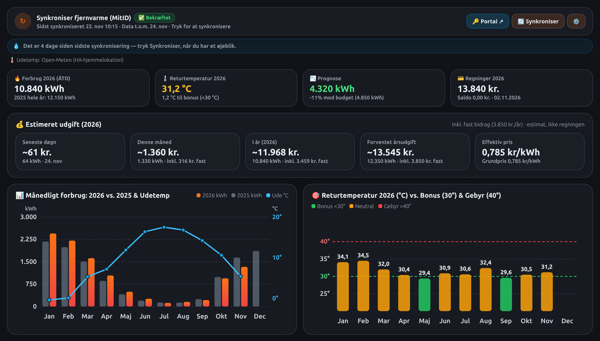
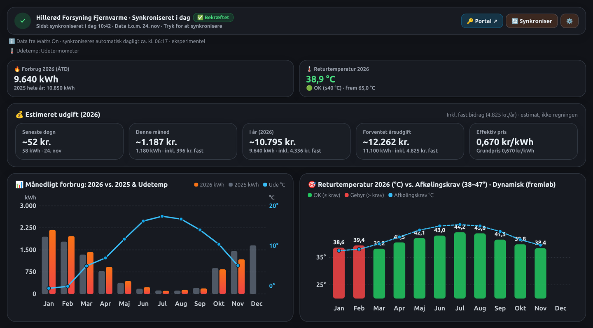
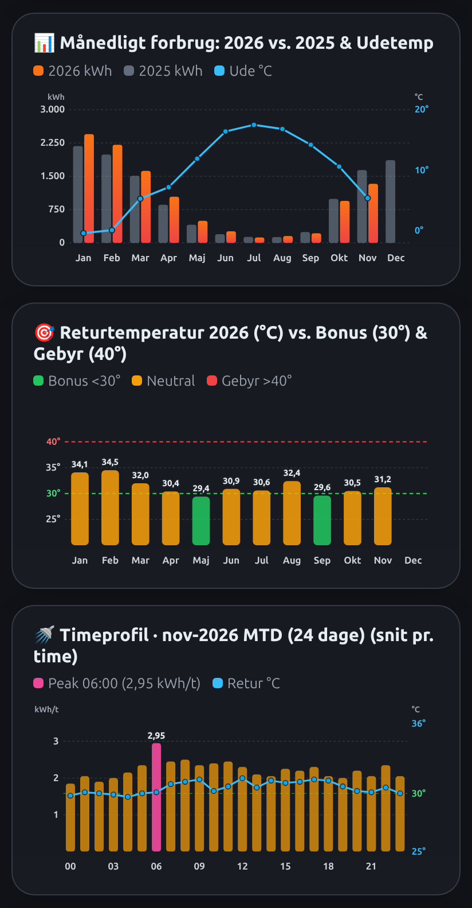

# 🔥 Dansk Fjernvarme — Home Assistant Integration & Dashboard

Komplet, **100 % lokal** Home Assistant-integration (`kmd_easy_energy`) med **Plug-and-Play dashboard-kort** (`custom:kmd-easy-energy-card`) til danske fjernvarmeværker på **KMD Easy Energy / Min Forsyning**, **E|Forsyning** og **Watts On** — direkte på Raspberry Pi, Home Assistant OS og Docker uden Chromium eller ekstern server.

> [!NOTE]
> Officielt tilgængelig i **HACS / Home Assistant Marketplace** (`v1.3.27` — se [`CHANGELOG.md`](CHANGELOG.md) for versionshistorik). **40 værker er bekræftet live**, **alle 76** forudfyldte værker har officielle 2026/2027-takster indbygget, og over **300+ E|Forsyning-værker** kan vælges direkte fra opsætningsguiden.

---

## 📸 Screenshots & Demo

  

| Desktop-overblik (inkl. 💰 årsudgift & weekend-puf) | Dynamisk afkølingstarif (fremløbsafhængig) |
| :---: | :---: |
|  |  |

| MitID QR & pris-/abonnementsindstillinger | Mobil-grafer & Spidstime |
| :---: | :---: |
|  |  |

---

## ✨ Hvad får du?

- **📊 Rent dashboard uden tomme kort:** Kortet tilpasser sig automatisk de data, dit værk leverer — grafer, KPI'er og indsigter uden data skjules helt. Mangler varmepris, fremløbstemperatur eller boligareal til faste bidrag, vises højst én diskret note med genvej til indtastning, som nemt kan lukkes (`✕`) og gemmes pr. enhed.
- **💰 Officielle 2026/2027-takster & årsudgift:** Alle 76 forudfyldte værker kommer med officielle forbrugspriser, bonus/gebyr-afkølingsregler (inkl. dynamisk fremløbsafhængig kurve) og valgfrie faste bidrag (`kr./m²/år` + `kr./år`) til beregning af forventet årsudgift.
- **🔐 100 % lokalt MitID & login i Home Assistant:** Understøtter både roterende **QR-kode** og **4-cifret engangskode** direkte på kortet for KMD-værker, samt **forbrugernummer/webpinkode eller e-mail/adgangskode** på E|Forsyning og browser-PKCE på Watts On.
- **⚡ Home Assistant Energy-dashboard:** Importerer timedata eller døgnserier som eksterne statistikker (`kWh`, `m³` og variabel varmeudgift i `DKK`), så historik og grafer passer uden dobbelttælling.
- **🌡️ Lokal-først udetemperatur & vejrindsigter:** Bruger din egen Home Assistant-temperatursensor (langtidsstatistik) først og supplerer automatisk med Open-Meteo for graddage (`HDD17`), R²-sammenhæng, grundlast og årsprognose.
- **📣 Privatlivsvenlig værk-feedback:** Tester du et endnu ikke bekræftet værk, kan du sende teknisk kompatibilitet (kun værk-ID og fundne målerenheder — ingen persondata) via knappen på kortet eller i et [GitHub-issue](https://github.com/DKAnord/fjernvarme-dk-ha/issues).

---

## 🚀 Kom godt i gang (3 trin)

1. **Installér fra HACS / Marketplace:** Klik på **Åbn i HACS** øverst (eller søg efter **Dansk Fjernvarme** under Integrationer i HACS) → klik **Hent (Download)** → **genstart Home Assistant**.
2. **Tilføj integrationen:** Klik på **Tilføj integration** øverst (eller gå til **Indstillinger → Enheder og tjenester → Tilføj integration → Dansk Fjernvarme**), vælg dit fjernvarmeværk, og følg guiden.
3. **Tilføj dashboard-kortet:** Redigér dit dashboard → **Tilføj kort** → vælg **Dansk Fjernvarme: Dashboard**. *(Lovelace-ressourcen oprettes og opdateres automatisk i storage-tilstand.)*

Lovelace YAML-tilstand, browser-cache &amp; fejlfinding

* Kortet serveres direkte fra integrationens statiske HTTP-rute uden at skrive til `/config/www/`.
* Bruger du **Lovelace i YAML-tilstand**, skal du registrere ressourcen manuelt som `JavaScript-modul` (se også [`dashboards/lovelace-plug-and-play.yaml`](dashboards/lovelace-plug-and-play.yaml)):
  * **URL:** `/kmd_easy_energy/kmd-easy-energy-card.js?v=1.3.27`
  * **Ressourcetype:** `module` (`JavaScript-modul`)
* Home Assistant kan cache statiske filer og ældre `/local/`-ressourcer i op til **31 dage**. Hvis du ser gammel brugerflade eller mangler QR-kode efter en opdatering: tjek ressource-URL'en under **Indstillinger → Dashboards → (`⋮`) Ressourcer**, lav en hård genindlæsning (**Ctrl+Shift+R** / **Cmd+Shift+R**), eller vælg **Nulstil frontend-cache** i Companion-appen. Du kan verificere den indlæste version på kortelementet via `data-kmd-card-version="1.3.27"`.

---

## 🏭 Understøttede varmeværker

### ✅ Bekræftet live (40 værker)

| Værk | By | Platform | Portal |
|---|---|---|---|
| **Kredsløb** | Aarhus / Brabrand | KMD Easy Energy | https://minvarme.kredslob.dk/ |
| **Energi Ikast** | Ikast | KMD (Min Forsyning 2) | https://energi-ikast.dk/ |
| **Frederikshavn Forsyning** | Frederikshavn | KMD Easy Energy | https://www.forsyningen.dk/selvbetjening |
| **Bornholms Energi & Forsyning (BEOF)** | Bornholm | KMD (Min Forsyning 2) | https://minforsyning.beof.dk/ |
| **Kalundborg Forsyning** | Kalundborg | KMD (Min Forsyning 2) | https://kalfor.dk/selvbetjening/min-forsyning |
| **Albertslund Forsyning** | Albertslund | KMD (Min Forsyning 2) | https://forsyning.albertslund.dk/selvbetjening |
| **Vestforsyning** | Holstebro | KMD (Min Forsyning) | https://www.vestforsyning.dk/selvbetjening/ |
| **Silkeborg Forsyning** | Silkeborg | KMD (Min Forsyning 2) | https://www.silkeborgforsyning.dk/selvbetjening/ |
| **Brønderslev Forsyning** | Brønderslev | KMD (Min Forsyning 2) | https://www.bronderslevforsyning.dk/ |
| **Aalborg Forsyning** | Aalborg | Watts On | https://aalborgforsyning.dk/services/forbrug/watts-on/ |
| **Fjernvarme Fyn** | Odense / Fyn | Watts On | https://www.fjernvarmefyn.dk/spar-paa-energien/overblik/watts-on-app/ |
| **Hillerød Forsyning** | Hillerød | Watts On | https://hfors.dk/selvbetjening/se-forbrug-regninger/watts-on-din-forbrugsapp-til-vand-varme |
| **Sorø Fjernvarme** | Sorø | E\|Forsyning | https://eforsyning.dk/soroe/ |
| **Middelfart Fjernvarme** | Middelfart | E\|Forsyning | https://eforsyning.dk/middelfartfjernvarme/ |
| **Hadsund Fjernvarme** | Hadsund | E\|Forsyning | https://eforsyning.dk/hadsundfjernvarme/ |
| **Hedensted Fjernvarme** | Hedensted | E\|Forsyning | https://eforsyning.dk/hedenstedfjernvarme/ |
| **Dronninglund Fjernvarme** | Dronninglund | E\|Forsyning | https://eforsyning.dk/dronninglundfjernvarme/ |
| **Kongerslev Fjernvarme** | Kongerslev | E\|Forsyning | https://eforsyning.dk/kongerslev/ |
| **Grenaa Varmeværk** | Grenaa | E\|Forsyning | https://eforsyning.dk/grenaa-varmevaerk/ |
| **Sønderborg Varme** | Sønderborg | E\|Forsyning | https://www.sonderborg-varme.dk/eforsyning/ |
| **Vinderup Varmeværk** | Vinderup | E\|Forsyning | https://eforsyning.dk/vinderupvarme/ |
| **Marstal Fjernvarme** | Marstal | E\|Forsyning | https://www.solarmarstal.dk/eforsyning/ |
| **Vestforbrænding** | Glostrup / Storkøbenhavn | E\|Forsyning | https://eforsyning.dk/vestfor/ |
| **Spjald Fjernvarme- og Vandværk** | Spjald | E\|Forsyning | https://eforsyning.dk/spjaldvarme/ |
| **Odder Forsyningsselskab I/S** | Odder | E\|Forsyning | https://eforsyning.dk/odderforsyningsselskab-varme/ |
| **Hammel Fjernvarme a.m.b.a.** | Hammel | E\|Forsyning | https://eforsyning.dk/hammelfjernvarme/ |
| **Greve Fjernvarme** | Greve | E\|Forsyning | https://eforsyning.dk/grevefjernvarme/ |
| **Viborg Varme** | Viborg | E\|Forsyning | https://eforsyning.dk/viborg/ |
| **Aalestrup-Nørager Energi a.m.b.a.** | Aalestrup / Nørager | E\|Forsyning | https://eforsyning.dk/an-energi-varme/ |
| **Aabenraa Fjernvarme** | Aabenraa | E\|Forsyning | https://eforsyning.dk/aabenraa-fjernvarme/ |
| **Fjernvarme Horsens** | Horsens | E\|Forsyning | https://eforsyning.dk/horsens/ |
| **Thisted Varmeforsyning** | Thisted | E\|Forsyning | https://eforsyning.dk/thisted-varmeforsyning/ |
| **Haslev Fjernvarme A.m.b.a.** | Haslev | E\|Forsyning | https://eforsyning.dk/haslev-fjernvarme/ |
| **Lemvig Varmeværk a.m.b.a.** | Lemvig | E\|Forsyning | https://eforsyning.dk/lemvig/ |
| **Gladsaxe Fjernvarme** | Gladsaxe | E\|Forsyning | https://eforsyning.dk/gladsaxe/ |
| **Norfors Fjernvarme** | Hørsholm / Nordsjælland | E\|Forsyning | https://eforsyning.dk/norfors/ |
| **Hornslet Fjernvarme A.m.b.a.** | Hornslet | E\|Forsyning | https://eforsyning.dk/hornslet-fjernvarme/ |
| **Holme Lundshøj Fjernvarme amba** | Højbjerg | E\|Forsyning | https://eforsyning.dk/hl-fjernvarme-lundshoej/ |
| **Løsning Fjernvarme a.m.b.a.** | Løsning | E\|Forsyning | https://eforsyning.dk/losningfjernvarme/ |
| **Hadsten Varmeværk a.m.b.a.** | Hadsten | E\|Forsyning | https://eforsyning.dk/hadstenvarme/ |

Øvrige 36 forudfyldte værker (🧪 afventer 1. live-test) + 300+ E|Forsyning-værker

Alle tilbagemeldinger på værker uden live-bekræftelse er meget velkomne — brug feedback-knappen på kortet eller opret et [GitHub-issue](https://github.com/DKAnord/fjernvarme-dk-ha/issues) (uden persondata):

* **KMD Easy Energy / Min Forsyning (8):** Galten Varmeværk, Struer Energi, Envafors / SK Forsyning, Frederiksberg Forsyning, Lolland Forsyning, Halsnæs Forsyning, Kerteminde Forsyning, Nyborg Forsyning & Service *(samt Brugerdefineret URL)*.
* **E\|Forsyning (27 forudfyldte + 300+ i søgeoversigt):** Hjørring Varmeforsyning, Egedal Fjernvarme A/S, Fredericia Fjernvarme, Vejle Fjernvarme, SONFOR Varme, Køge Fjernvarme, Avedøre Fjernvarme, Solrød Fjernvarme, Assens Fjernvarme, Ringkøbing Fjernvarme, Hvide Sande Fjernvarme, Kibæk Varmeværk, Kjellerup Fjernvarme, Ansager Varmeværk, Dianalund Fjernvarme, Nykøbing Sjælland Varmeværk, Næstved Fjernvarme, Svendborg Fjernvarme, Gentofte Fjernvarme, Rødovre Fjernvarme, Brøndby Fjernvarme, Tårnby Forsyning, Skive Fjernvarme, Haderslev Fjernvarme, Skanderborg-Hørning Fjernvarme, Vordingborg Fjernvarme og Hobro Varmeværk. Derudover kan alle 300+ værker på `eforsyning.dk` vælges direkte via den indbyggede søgning eller portal-URL/slug.
* **Watts On (1):** Forsyning Helsingør *(Novafos er kun vand, og Hornbæk Fjernvarme er undtaget på Forsyning Helsingørs Watts On-løsning)*.

---

## 🔑 Opsætning & synkronisering pr. platform

### KMD Easy Energy / Min Forsyning (MitID)
1. Opret integrationen i Home Assistant, vælg dit KMD-værk og indtast evt. dit **MitID Bruger-ID** *(oprettelsen starter endnu ikke et login)*.
2. Tilføj **Dansk Fjernvarme: Dashboard** på dit dashboard og tryk **🚀 Gem & Start MitID-synkronisering**.
3. **Åbn straks MitID-appen på telefonen og lås den op** *(MitID danner først QR-/engangskoden i det øjeblik, appen åbnes)*.
4. Scan **QR-koden** fra computer/tablet, eller indtast den **4-cifrede engangskode**, hvis du godkender på samme telefon som MitID-appen.

> [!TIP]
> **Undgå `CAP008` og opsætning på samme telefon:** Åbn ikke værkets portal i en anden browser-fane samtidig med et MitID-login i Home Assistant. Godkender du fra *samme telefon* som MitID-appen, skal **Engangskoder** være aktiveret under **MitID-app → Menu (⚙️) → Godkend med QR- eller engangskoder** *(MitID har 24 timers sikkerhedskarantæne første gang det slås til)*. Har du aldrig været logget ind hos dit værk før, så log ind én gang i en almindelig browser først for at acceptere vilkår.

**Sådan synkroniserer KMD (session-baseret):** KMD udsteder kun en adgang, der gælder ca. 1 time, uden refresh token. Hvert tryk på **🔄 Synkroniser** er derfor ét MitID-login, der henter alle nye data (inkl. timehistorik og evt. afkøling/temperaturer fra `/api/cooling/getcoolinginfo`), opdaterer den lokale cache og straks kasserer adgangstokenet. Integrationen poller aldrig i baggrunden og laver ingen fejlagtige "log ind igen"-reparationer. Vil du mindes om det, viser kortet automatisk en rolig weekend-note lørdag/søndag, hvis der ikke er synkroniseret torsdag–lørdag *(kan slås fra under konfiguration)*.

---

### E\|Forsyning (`eforsyning.dk`)
* **Login uden MitID:** Vælg dit værk (eller **🔎 Søg blandt alle 300+ E|Forsyning-værker** / indsæt portal-URL eller slug som `horsens` — `forsyningid` hentes automatisk uden F12) og indtast **forbrugernummer** og **webpinkode** fra din varmeregning — eller din **e-mail** og **adgangskode**, hvis du har oprettet e-mail-login på `eforsyning.dk`.
* **Automatisk daglig synkronisering:** Henter nye aflæsninger automatisk ca. kl. 06:17 hver morgen *(kan ændres eller slås fra)* samt manuelt med **Synkroniser nu**.
* **Datadækning:** Leverer døgn- og månedstal (`kWh`, `m³`, returtemperatur og evt. `Forv_Retur` fra værket) — ikke timedata, saldo eller budgetprognose. Kortet viser kun de kort og grafer, der er data til. *(Døgntal dateres efter **forbrugsdagen** `FraDato` — dvs. 1 dag tidligere end portalens/CSV'ens aflæsningsdato `TilDato`, vist med `aflæst DD/MM` i tooltippen, så forbrug følger udetemperatur/graddage og Energy-døgnbuckets — mens måneds- og årstemperaturer bruger E|Forsynings serverberegnede `afMaanedsvis`-gennemsnit fra `ENG2`/`TV2`.)*

---

### Watts On *(eksperimentel, uofficiel API)*

> [!WARNING]
> **Uofficiel app-API (ikke-kommerciel brug på eget ansvar):** Watts On har ingen dokumenteret offentlig API. Integrationen bruger appens egne endpoints og kan ophøre med at virke, hvis Watts ændrer grænsefladen.

1. Sørg for at din varmemåler først er tilføjet og aktiv i **Watts On-appen** (log ind i guiden med din **Watts On-e-mail og adgangskode** — ikke MitID eller værkets egen selvbetjening).
2. Tilføj **Dansk Fjernvarme** på en **computer** (ikke telefonen med Watts-appen), vælg dit Watts On-værk, **højreklik** på login-linket og vælg **Åbn link i ny fane**.
3. **Vigtigt — åbn F12 *før* du logger ind:** På den nye fane trykker du **F12** → fanen **Network / Netværk** → slå **Preserve log / Bevar log** til, og log derefter ind med din Watts On-konto. Til sidst forsøger browseren at åbne en `msauth://…`-adresse *(det fejler forventeligt i desktop-browsere)*.
4. Kopiér den fulde `msauth://`-adresse (**Chrome/Edge:** fra **Console** *"Failed to launch 'msauth://…'"* eller **Network** → sidste `302`-omdirigering → *Headers* → `location`; **Firefox:** fra adresselinjen/fejlsiden) og indsæt den i dialogen inden for ca. 10 minutter. Integrationen gemmer kun et roterende refresh token, synkroniserer timedata (`En`, `Vol`, `TI`/`TO`) dagligt kl. ca. 06:17 og viser diskret besked på kortet, hvis login senere udløber.

Watts On fejlfinding: energienhed &amp; endpoint-skabelon

* Under integrationens indstillinger kan du ved behov vælge **energienhed** (`auto`, `kWh`, `MWh`, `GJ`), hvis dit værks måler rapporterer en afvigende faktor.
* Bruger et nyt/ikke-testet Watts On-værk en anden varme-sti, kan du angive en brugerdefineret **endpoint-skabelon**: stier der slutter på `/recent` får automatisk `?newerThan=`, mens andre stier får `?startDate=`.

---

## ⚡ Energy-dashboard, priser & udetemperatur

* **Home Assistant Energy-dashboard:** Home Assistant har endnu ikke en selvstændig fjernvarmekategori, så tilføj de eksterne statistikker **`kmd_easy_energy:energy_<entry_id>`** (`kWh`) og **`kmd_easy_energy:volume_<entry_id>`** (`m³`) under **Gas** i **Indstillinger → Dashboards → Energi** *(lad evt. feltet til *flow rate* stå tomt)*. Under prisindstillingen kan du vælge **Brug en entitet, der sporer de samlede omkostninger** (*Use an entity tracking the total costs*) og pege på **`kmd_easy_energy:cost_<entry_id>`** (`DKK`). Prisstatistikken beregnes time-for-time (eller døgn-for-døgn på E|Forsyning) ud fra dine variable takster — dvs. **ekskl. faste bidrag**, følger automatisk værkets takstskift (f.eks. 2026→2027 og `effective_from`-datoer) samt måneds-/dags-motivationstarif når returtemperatur kendes *(bruger du manuel kWh-pris i ⚙️, gælder din indtastede pris ensartet for hele historikken)*. Brug *ikke* måned-til-dato- eller års-sensorerne (`sensor.*_energy`, `sensor.*_overview` eller `sensor.*_year_cost`) i Energy-dashboardet.
* **Varmepriser, faste bidrag & afkølingskrav:** For **alle 75/75** værker er officielle 2026/2027-takster klar ud af boksen. Tryk **⚙️** på kortet (eller åbn *Konfigurer* på integrationen) for at tilpasse `kr./kWh`, boligareal (`m²`) til arealafgift, fast årsabonnement (`kr./år`), fremløbstemperatur (`°C`) eller bonus-/gebyrgrænser. Sæt `0` for at falde tilbage på værkets standard (og på E|Forsyning bruges `Forv_Retur` automatisk, når værket sender den).
* **Udetemperatur (lokal først):** Integrationen bruger døgnmiddel fra din egen Home Assistant-sensor (`device_class: temperature` + `state_class: measurement` via langtidsstatistik, minimum 18 timer pr. døgn) og kalder kun Open-Meteo for historiske/manglende dage uden sensordækning. Som standard bruges Home Assistants hjemmelokation (alternativt egen lokation eller værkets by); koordinater vises aldrig i UI.

---

## 🧩 Entiteter & tjenester

Integrationen opretter kun de entiteter, som din valgte platform og måler faktisk understøtter (`capabilities` på overblikssensoren — ved Watts On tilføjes volumen og returtemperatur automatisk, når første synkronisering finder felterne).

Komplet oversigt over sensorer, binære sensorer, knapper og tjenester

**Sensorer & kontroller pr. værk:**
* `sensor.<værk>_overview` — ÅTD-forbrug (`kWh`) og komplette dashboard-attributter (`annual`, `monthly`, `daily`, `hourly`, `return_temp`, `weather`, `insights`, `forecast`, `billing`, `cost_estimate`, `capabilities`)
* `sensor.<værk>_energy` — Aktuel måneds forbrug (`kWh`)
* `sensor.<værk>_volume` — Volumen (`m³`, cirkulerende fjernvarmevand)
* `sensor.<værk>_return_temperature` — Returtemperatur (`°C`)
* `sensor.<værk>_balance` — Saldo (`DKK`, når understøttet)
* `sensor.<værk>_heating_degree_days_7d` — 7-dages graddage (`HDD17`)
* `sensor.<værk>_energy_price` / `sensor.<værk>_effective_energy_price` — Grundpris & effektiv varmepris (`DKK/kWh`)
* `sensor.<værk>_latest_day_cost` / `sensor.<værk>_month_cost` / `sensor.<værk>_year_cost` — Estimerede udgifter (`DKK`, inkl. valgfrie faste bidrag)
* `sensor.<værk>_motivation_status` / `sensor.<værk>_motivation_adjustment` — Motivationstarif (`bonus` / `neutral` / `penalty` og `DKK/kWh`)
* `sensor.<værk>_kwh_per_hdd` — Vejrkorrigeret effektivitet (`kWh/HDD17`)
* `sensor.<værk>_normalized_annual_energy` / `sensor.<værk>_forecast_annual_energy` — Normalårskorrigeret forbrug & årsprognose (`kWh`)
* `sensor.<værk>_last_synced` — Tidspunkt for seneste synkronisering
* `binary_sensor.<værk>_motivation_penalty` — Slår til i gebyrzonen
* `binary_sensor.<værk>_abnormal_consumption` — Slår til ved unormalt højt døgnforbrug for årstiden/ugedagen
* `binary_sensor.<værk>_sync_reminder` — Blød weekend-påmindelse ved manglende KMD-sync
* `button.<værk>_sync` — Knap til synkronisering

**Tjenester (`services.yaml`):**
* `kmd_easy_energy.sync` — Synkroniser valgt værk *(virker også for ikke-admin vægtablets)*
* `kmd_easy_energy.start_mitid_sync` *(kun admin)* — Start MitID-sync inkl. evt. opdatering af MitID Bruger-ID eller push-tjeneste
* `kmd_easy_energy.configure_utility` *(kun admin)* — Opdater takster, boligareal, fremløbstemp, værk eller lokation
* `kmd_easy_energy.refresh` — Genberegn afledte tal og udgifter ud fra lokal cache (kontakter ikke værket)
* `kmd_easy_energy.update_token` *(kun admin)* — Avanceret: engangssync med manuelt bearer token
* `kmd_easy_energy.reset_setup` *(kun admin)* — Nulstil opsætningsguide på kortet

---

## 🔒 Privatliv & sikkerhed

- **Direkte kommunikation:** Home Assistant taler kun direkte med dit valgte varmeværk (KMD / NemLog-in / MitID, `eforsyning.dk` eller Watts On) samt Open-Meteo for manglende vejrdata.
- **Lokal lagring:** Forbrugsdata caches lokalt i `.storage/kmd_easy_energy.<entry_id>` (ikke i `/config/www/`). MitID Bruger-ID og evt. E|Forsyning-pinkode eller roterende Watts On refresh token opbevares krypteret i Home Assistants `.storage/core.config_entries` som almindelige integrationers adgangsdata.
- **Engangsadgang på KMD:** MitID access tokens gemmes aldrig på disk og kasseres straks efter synkronisering.
- **Ingen koder i historikken:** Live QR-frames og engangskoder sendes over integrationens eget websocket-abonnement (`kmd_easy_energy/mitid/subscribe`) og skrives **ikke** til sensorattributter eller Home Assistants recorder/event-bus *(hvis du tilvælger mobil-push af 4-cifret engangskode, logger HA tjenestekald i recorderen i kodens korte levetid)*.
- **Sikker support:** **Download diagnostics** redigerer automatisk tokens, MitID-ID, kunde-/måler-ID, GPS-koordinater, push-tjenester og adresser.

---

## 🇬🇧 English Summary

**Dansk Fjernvarme** (`kmd_easy_energy`) is a 100% local Home Assistant integration and plug-and-play Lovelace dashboard card (`custom:kmd-easy-energy-card`) supporting Danish district heating utilities across **KMD Easy Energy / Min Forsyning** (built-in Python MitID QR & 4-digit OTP — no external browser add-on), **E|Forsyning** (consumer no. + web PIN or e-mail + password, 300+ searchable utilities), and **Watts On** *(experimental/unofficial browser-PKCE backend)*.

- **Quick setup:** Install via HACS / Home Assistant Marketplace, add the **Dansk Fjernvarme** integration, and place **Dansk Fjernvarme: Dashboard** on any view. The card is served directly at `/kmd_easy_energy/kmd-easy-energy-card.js?v=1.3.27` (managed automatically in storage mode; for YAML mode add it as a `module`, keeping in mind HA may cache legacy `/local/` resources for up to `31 days`).
- **Tariffs & zero blank cards:** **40 utilities** are confirmed live and **all 76** curated presets ship with official 2026/2027 tariffs (including dynamic supply-temperature cooling curves and optional fixed fees). Sections without underlying data are strictly hidden, with at most a compact dismissible hint (persisted per entry in `localStorage` or disabled via `hide_manual_hints`) suggesting optional manual fields like heat price, supply temperature, or heated area.
- **Energy dashboard & weather:** Add external statistics `kmd_easy_energy:energy_<entry_id>`, `kmd_easy_energy:volume_<entry_id>`, and `kmd_easy_energy:cost_<entry_id>` (*Use an entity tracking the total costs*, variable heating cost excl. fixed fees) to HA Energy. Degree-day weather insights prefer your local HA temperature sensor's long-term statistics and only query Open-Meteo for missing days.
- **History & licensing:** Full release notes live in [`CHANGELOG.md`](CHANGELOG.md), and third-party open-source attributions live in [`NOTICE`](NOTICE).

---

## 🙏 Tak & Credits

En stor tak til de open-source-projekter og fællesskabstestere, der har gjort integrationen mulig:

- **[kpoppel/homeassistant-eforsyning](https://github.com/kpoppel/homeassistant-eforsyning)** *(Apache-2.0)* — Oprindelig E|Forsyning-integration; protokollen er genimplementeret asynkront i `api/eforsyning_client.py`.
- **[TheRealBatBro/Home-Assistant-Novafos-V2](https://github.com/TheRealBatBro/Home-Assistant-Novafos-V2)** *(MIT)* — Inspiration til Watts On B2C/PKCE-login og API-struktur i `api/wattson_client.py`.
- **[Hundter/MitID-BrowserClient](https://github.com/Hundter/MitID-BrowserClient)** *(MIT)* — MitID SRP-klient til lokalt MitID-login i Home Assistant.
- **Fællesskabstestere:** **[@dkvand](https://github.com/dkvand)** (Watts On / Aalborg Forsyning + kr.-estimat), **[@BenzDK](https://github.com/BenzDK)** (Energi Ikast), **[@tirolel](https://github.com/tirolel)** (Frederikshavn Forsyning), **[@Crallebab](https://github.com/Crallebab)** (Sorø Fjernvarme), **Jesper Madsen** (Middelfart Fjernvarme), **[@cokeman0](https://github.com/cokeman0)** (Hadsund & Kongerslev Fjernvarme), **[@PalleEngkjaer](https://github.com/PalleEngkjaer)** (Fjernvarme Fyn), **[@MichaelDepner](https://github.com/MichaelDepner)** (Hillerød Forsyning), **[@henningpetersen](https://github.com/henningpetersen)** (Hedensted Fjernvarme), **[@cctreeacdk](https://github.com/cctreeacdk)** (Grenaa Varmeværk), **[@CarstenLeonhardt](https://github.com/CarstenLeonhardt)** (Sønderborg Varme), **[@askov68](https://github.com/askov68)** (Vinderup Varmeværk), **[@Milfeldt](https://github.com/Milfeldt)** (Marstal Fjernvarme), **[@Hjeresen](https://github.com/Hjeresen)** (Vestforbrænding), **[@CarstenHoell](https://github.com/CarstenHoell)** (Silkeborg Forsyning), **[@TheHelzing](https://github.com/TheHelzing)** (Spjald Fjernvarme- og Vandværk), **[@Bluhme1](https://github.com/Bluhme1)** (Odder Forsyningsselskab I/S), **[@andreasjuhl2000](https://github.com/andreasjuhl2000)** (Hammel Fjernvarme a.m.b.a.), **[@tr4x1s](https://github.com/tr4x1s)** (Brønderslev Forsyning), **[@heki1972](https://github.com/heki1972)** (Greve Fjernvarme), **[@snoopylarsen-wq](https://github.com/snoopylarsen-wq)** & **[@Rimers](https://github.com/Rimers)** (Vestforsyning), **[@lassealfastsen](https://github.com/lassealfastsen)** (Aalestrup-Nørager Energi a.m.b.a.), **[@MadzDK](https://github.com/MadzDK)** (Viborg Varme), **[@GuezzDK](https://github.com/GuezzDK)** (Aabenraa Fjernvarme), **[@Larven1337](https://github.com/Larven1337)** & **[@FrankLeth](https://github.com/FrankLeth)** (Fjernvarme Horsens), **[@dezito](https://github.com/dezito)** (Thisted Varmeforsyning), **[@Kaldru](https://github.com/Kaldru)** (Haslev Fjernvarme A.m.b.a.), **[@Un1t7](https://github.com/Un1t7)** (Lemvig Varmeværk a.m.b.a.), **[@IvanSoenderholm](https://github.com/IvanSoenderholm)** (Gladsaxe Fjernvarme), **[@Christianokholmbonde](https://github.com/Christianokholmbonde)** (Norfors Fjernvarme), **[@simonruds-sandcraft](https://github.com/simonruds-sandcraft)** (Hornslet Fjernvarme A.m.b.a.), **[@sorentorp](https://github.com/sorentorp)** (Holme Lundshøj Fjernvarme amba), **[@Dalle75](https://github.com/Dalle75)** (Løsning Fjernvarme a.m.b.a.) og **[@clausn78](https://github.com/clausn78)** (Hadsten Varmeværk a.m.b.a.).

Se [`NOTICE`](NOTICE) for fulde licens- og copyright-tekster og [`CHANGELOG.md`](CHANGELOG.md) for hele ændringshistorikken.
