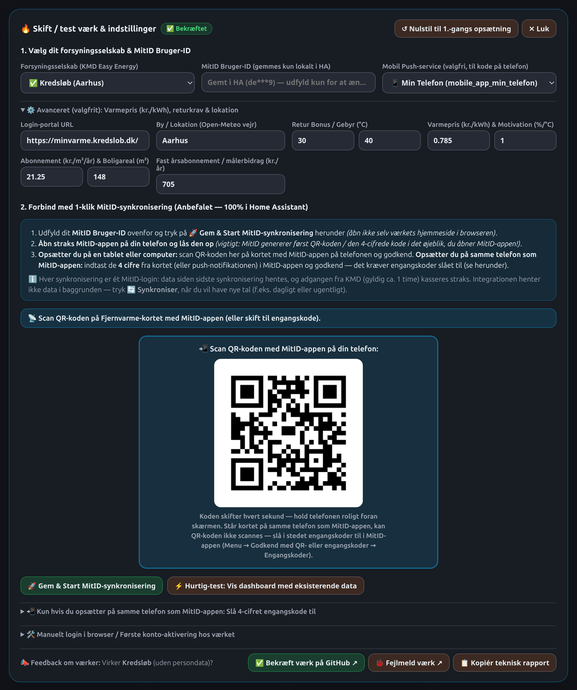

# 🔥 Fjernvarme (KMD Easy Energy) — HA Connector & Dashboard

Komplet, **100% lokal** Home Assistant-integration (`kmd_easy_energy`) og **Plug-and-Play Lovelace-dashboard** (`custom:kmd-easy-energy-card`) til danske fjernvarmeværker på **KMD Easy Energy** (`easy-energy-plugin-api.kmd.dk`).

Log ind med **MitID direkte i Home Assistant** i ren Python (OIDC PKCE + NemLog-in + MitID SRP) — **ingen Chromium, ingen ekstern server eller add-on** påkrævet. Kører direkte på Raspberry Pi, Home Assistant OS og Docker.

> [!NOTE]
> **🧪 Beta-testere søges (`v0.3.0-beta.3`):** Integrationen er indtil videre kun testet live hos **Kredsløb**. De øvrige 16 KMD-værker, Hjørring Varmeforsyning (E|Forsyning) og brugerdefineret portal-URL er endnu ikke afprøvet live. Alle tilbagemeldinger er guld værd — også *"det virker ikke hos mit værk"*. Brug feedback-knappen på kortet eller [opret et issue](https://github.com/DKAnord/kmd-fjernvarme-ha/issues) med navnet på dit værk.

---

## 📸 Screenshots & Demo

  

| Desktop-overblik (inkl. weekend-påmindelse) | MitID QR & Notifikations-dropdown | Mobil-grafer & Spidstime |
| :---: | :---: | :---: |
|  |  |  |

---

## ✨ Funktioner

- **🔐 100% indbygget MitID-login i Home Assistant:** Understøtter både **4-cifret engangskode** (vises direkte på dashboardet + valgfri push-notifikation) og **roterende QR-kode**. Dit MitID Bruger-ID gemmes kun lokalt i Home Assistants krypterede ConfigEntry.
- **🏭 Smart værk-vælger:** Vælg mellem bekræftede værker (`✅ Bekræftet`) og kandidater (`🧪 Afventer første test`), eller indtast en brugerdefineret portal-URL.
- **📊 Plug-and-Play Fjernvarme Dashboard (`custom:kmd-easy-energy-card`):**
  - **Førstegangsopsætning (Wizard):** Guider dig trin-for-trin igennem valg af værk, MitID Bruger-ID og første synkronisering.
  - **Daglig drift:** 1-klik sync-banner, **4 KPI-kort** (ÅTD forbrug, returtemperatur vs. bonus/gebyr, prognose mod budget, regninger & saldo), **5 interaktive SVG-grafer** (månedligt forbrug vs. sidste år + udetemp, returtemperatur, timeprofil, MTD vs. YTD, dagligt forbrug) og **4 Open-Meteo vejrindsigter** (R², grundlast, spidstime og kWh pr. graddag HDD17).
- **📣 Indbygget værk-feedback:** Testede du et nyt værk? Brug knappen **Bekræft på GitHub** direkte i kortet — den sender kun tekniske metadata (værk-ID og fundne målerenheder) uden persondata, MitID-ID, tokens eller forbrugstal.

---

## 🏭 Understøttede varmeværker

### ✅ Bekræftet (Testet live)
| Værk | By | Login-portal | Status |
|---|---|---|---|
| **Kredsløb** | Aarhus / Brabrand | https://minvarme.kredslob.dk/ | ✅ Bekræftet |

### 🧪 Afventer første test (Verificerede KMD / Min Forsyning-portaler)
| Værk | By | Login-portal | Status |
|---|---|---|---|
| **Galten Varmeværk** | Galten | https://minvarme.kredslob.dk/ | 🧪 Afventer 1. test |
| **Energi Ikast** | Ikast | https://energi-ikast.dk/ | 🧪 Afventer 1. test |
| **Struer Energi** | Struer | https://struerenergi.dk/selvbetjening/ | 🧪 Afventer 1. test |
| **Envafors / SK Forsyning** | Slagelse / Næstved / Sorø | https://skenergi.dk/minforsyning/ | 🧪 Afventer 1. test |
| **Frederikshavn Forsyning** | Frederikshavn | https://www.forsyningen.dk/selvbetjening | 🧪 Afventer 1. test |
| **Vestforsyning** | Holstebro | https://www.vestforsyning.dk/selvbetjening/ | 🧪 Afventer 1. test |
| **Bornholms Energi & Forsyning (BEOF)** | Bornholm | https://minforsyning.beof.dk/ | 🧪 Afventer 1. test |
| **Kalundborg Forsyning** | Kalundborg | https://kalfor.dk/selvbetjening/min-forsyning | 🧪 Afventer 1. test |
| **Albertslund Forsyning** | Albertslund | https://forsyning.albertslund.dk/selvbetjening | 🧪 Afventer 1. test |

### 🔎 Kandidater (KMD Easy Energy-kunder — afventer test)
- **Nykøbing Sjælland Varmeværk** · **Langeland Energi & Forsyning (LEF)** · **Forsyning Helsingør (Mit FH)** · **Provas (Haderslev)** · **Skanderborg Forsyning** · **SAMN Forsyning** · **go'energi** · samt *Brugerdefineret URL*

### 🧪 E|Forsyning (eksperimentel — beta-testere søges)
- **Hjørring Varmeforsyning** ([eforsyning.dk/hjvarme](https://eforsyning.dk/hjvarme)) · samt *Andet E|Forsyning-værk* (kræver værkets forsyningid)

Se [E|Forsyning-backend](#-eforsyning-backend-eksperimentel) nedenfor.

---

## 📦 Installation via HACS

1. Åbn **HACS** i Home Assistant → **Integrationer** → menuen (`⋮` øverst til højre) → **Brugerdefinerede arkiver (Custom repositories)**.
2. Tilføj:
   - **Repository:** `https://github.com/DKAnord/kmd-fjernvarme-ha`
   - **Kategori:** `Integration`
3. Søg efter **Fjernvarme (KMD)** i HACS, klik **Hent (Download)**, slå **Vis betaversioner (Show beta versions)** til, vælg **`v0.3.0-beta.3`**, og genstart Home Assistant.
4. Gå til **Indstillinger → Enheder og tjenester → Tilføj integration → Fjernvarme (KMD Easy Energy)**, og vælg dit varmeværk.
5. Tilføj dashboard-kortet som ressource under **Indstillinger → Dashboards → (`⋮`) Ressourcer → Tilføj ressource**:
   - **URL:** `/local/js/kmd-easy-energy-card.js`
   - **Ressourcetype:** `JavaScript-modul`
   *(Integrationen kopierer automatisk kortet til `/config/www/js/kmd-easy-energy-card.js` ved opstart).*
6. Tilføj kortet **Fjernvarme (KMD Easy Energy): Dashboard** på et dashboard via den visuelle kortvælger (eller se [dashboards/lovelace-plug-and-play.yaml](dashboards/lovelace-plug-and-play.yaml)).

---

## 🔄 Sådan synkroniserer integrationen (session-baseret)

KMD udsteder kun en adgang (access token), der gælder ca. 1 time, og ingen refresh token. Derfor:

- **Hvert tryk på 🔄 Synkroniser er ét MitID-login.** Integrationen henter alt siden sidste synkronisering (inkl. timedata til Energy-dashboardet) og **kasserer adgangen straks**. Den gemmes ikke i konfigurationen eller cachen.
- **Ingen baggrundshentning:** Integrationen kontakter ikke KMD af sig selv. Sensorerne viser de senest hentede tal, og `sensor.<værk>_last_synced` (**Sidst synkroniseret**) viser hvornår. Efter en genstart af Home Assistant indlæses tallene fra den lokale cache uden at kontakte KMD.
- **Ingen "log ind igen"-reparationer:** Et udløbet token er normalt og giver ingen fejl. Kun et login, der reelt fejler, vises som fejl på kortet.
- **Første synkronisering** henter op til et års timehistorik. Senere synkroniseringer henter fra sidste synkronisering og frem (og eventuelle manglende måneder). Flere synkroniseringer samme dag er fine — Energy-statistikken skrives pr. time og bliver ikke dobbelt.
- **Blød påmindelse i weekenden:** Lørdag og søndag viser kortet en lille, rolig info-linje lige under Synkroniser-knappen — fx *"💧 Det er 4 dage siden sidste synkronisering — tryk Synkroniser, når du har et øjeblik."* — hvis der ikke er synkroniseret torsdag, fredag eller lørdag samme uge (en synkronisering søndag fjerner den også). Mandag–fredag vises ingen påmindelse. Det er et venligt puf, ikke en fejl: ingen rød/advarsels-styling, ingen persistent notification, ingen reparation (repair) og ingen push. `binary_sensor.<værk>_sync_reminder` kan bruges i egne automatiseringer, og påmindelsen kan slås fra under integrationens indstillinger.

---

## 🧪 E|Forsyning-backend (eksperimentel)

> [!WARNING]
> E|Forsyning-understøttelsen er **ikke testet live** endnu. Har du fjernvarme fra et E|Forsyning-værk (fx Hjørring Varmeforsyning), så hjælp gerne som beta-tester og meld tilbage i et GitHub-issue — uden persondata.

Nogle værker bruger ikke KMD Easy Energy men **E|Forsyning** (eforsyning.dk / DFF-EDB). For dem bruger integrationen en anden backend, men **samme kort, sensorer, Energy-statistik og påmindelse**:

- **Login uden MitID:** Vælg værket under *Tilføj integration* og indtast **forbrugernummer** og **webpinkode** fra din varmeregning. De gemmes i Home Assistant som andre integrationers adgangskoder, logges aldrig og redigeres i diagnostics. Har kontoen flere installationer, vælger du én.
- **Automatisk daglig synkronisering** (standard kl. ca. 06:17, kan ændres eller slås fra under indstillinger). Knappen **Synkroniser nu** virker også. Weekend-påmindelsen er derfor slået fra som standard (kan slås til).
- **Data er daglige aflæsninger** (kWh, m³, frem- og returtemperatur) — ikke timedata. Energy-statistikken (`kmd_easy_energy:energy_<entry_id>` / `:volume_<entry_id>`) får én række pr. døgn (ved midnat), så døgntallene er rigtige, men der er ingen timeprofil.
- **Kortet viser kun det, der er data til:** ingen timeprofil, ingen saldo/regning og ingen budgetprognose for E|Forsyning, og ingen MitID-felter. Der står *Data fra E|Forsyning* under banneret.
- **Årstal** vises kun, når historikken dækker hele året (første synkronisering henter indeværende og forrige afregningsår), så du ser hellere "intet tal" end et forkert tal.
- **Andet E|Forsyning-værk:** Vælg *Andet E|Forsyning-værk* og indtast værkets **forsyningid**: åbn værkets side på eforsyning.dk, tryk F12 → *Netværk*, søg efter `GetVaerkSettings`, og kopiér værdien efter `forsyningid=`. Hjørring Varmeforsyning er forudfyldt (`B30A6948-2461-4827-B8EB-5D93169CCB8B`, fundet på den offentlige side).

**Tak til [kpoppel/homeassistant-eforsyning](https://github.com/kpoppel/homeassistant-eforsyning)** (Apache-2.0): Login- og dataprotokollen er studeret fra det projekt og genimplementeret som en asynkron klient (`api/eforsyning_client.py`, markeret som afledt værk med ændringer). Se [NOTICE](NOTICE) og licensteksten i `custom_components/kmd_easy_energy/api/LICENSE-eforsyning-Apache-2.0.txt`. Bruger du kun E|Forsyning og vil have flere detaljer (fx regningslinjer), så kig også på kpoppels integration.

---

## 🔑 Førstegangsopsætning & MitID-guide

### Sådan gør du (3 enkle trin)
1. Indtast dit **MitID Bruger-ID** i opsætningskortet på dashboardet *(gemmes kun lokalt i Home Assistant)*, og tryk på **🚀 Gem & Start MitID-synkronisering**. *(Åbn ikke selv værkets hjemmeside i browseren samtidig — det giver MitID-fejl `CAP008`).*
2. **Åbn straks MitID-appen på din telefon og lås den op** — MitID danner først QR-koden / engangskoden i det øjeblik, appen åbnes.
3. **Opsætter du på en tablet eller computer:** scan QR-koden på dashboard-kortet med MitID-appen på telefonen, og godkend. **Opsætter du på samme telefon som MitID-appen:** indtast de **4 cifre** fra kortet (eller push-notifikationen) i MitID-appen, og godkend — det kræver, at engangskoder er slået til (se nedenfor).

> [!TIP]
> **Kun hvis du opsætter på samme telefon som MitID-appen: slå 4-cifret engangskode til**
> Bruger du en tablet eller computer til opsætningen og har MitID-appen på telefonen, skal du ikke ændre noget — scan blot QR-koden på kortet.
> Står kortet derimod på samme telefon som MitID-appen, kan QR-koden ikke scannes. Skift derfor fra QR-kode til 4-cifrede engangskoder i MitID-appen:
> **MitID-app → Menu (⚙️) → Godkend med QR- eller engangskoder → Engangskoder**.
> *Bemærk: MitID har af sikkerhedshensyn 24 timers ventetid ved første skift fra QR-kode til engangskode, hvorefter du bekræfter skiftet i appen.*

---

## 🧩 Entiteter & Tjenester

### Sensorer & Knap (oprettes pr. værk)
- `sensor.<værk>_overview` — Årsforbrug (kWh) + komplette dashboard-attributter (`annual`, `monthly`, `daily`, `hourly`, `return_temp`, `weather`, `insights`, `forecast`, `billing`)
- `sensor.<værk>_energy` — Aktuel måneds forbrug (`kWh`)
- `sensor.<værk>_volume` — Volumen (`m³`, `device_class: water` — cirkulerende fjernvarmevand, ikke drikkevand)
- `sensor.<værk>_return_temperature` — Returtemperatur (`°C`)
- `sensor.<værk>_balance` — Saldo (`DKK`)
- `sensor.<værk>_heating_degree_days_7d` — 7-dages graddage (`HDD17`) fra Open-Meteo
- `sensor.<værk>_energy_price` — Variabel varmepris (`DKK/kWh`), fra indstillinger eller offentliggjort takst
- `sensor.<værk>_motivation_status` — Motivationstarif (`bonus` / `neutral` / `gebyr`) ud fra returtemperatur
- `sensor.<værk>_motivation_adjustment` — Motivationsregulering (`DKK/kWh`, negativ = bonus)
- `sensor.<værk>_kwh_per_hdd` — kWh pr. graddag (HDD17)
- `sensor.<værk>_normalized_annual_energy` — Normalår-korrigeret årsforbrug (kWh)
- `sensor.<værk>_forecast_annual_energy` — Årsprognose (ÅTD + resterende normalår-HDD × kWh/HDD)
- `binary_sensor.<værk>_motivation_penalty` — Til, når returtemperaturen er i gebyrzonen
- `binary_sensor.<værk>_abnormal_consumption` — Til ved unormalt døgnforbrug (samme ugedag, HDD-justeret). Ingen automatisk notifikation.
- `sensor.<værk>_last_synced` — **Sidst synkroniseret** (tidsstempel for seneste MitID-synkronisering)
- `binary_sensor.<værk>_sync_reminder` — Blød weekend-påmindelse (til lør/søn uden synkronisering tors–lør). Attributter: `message` (venlig tekst), `short` (*"Ikke synkroniseret i X dage"*), `days_since_sync`, `last_sync`, `enabled`.
- `button.<værk>_sync` — 1-klik knap til at starte MitID-synkronisering (E|Forsyning: **Synkroniser nu**)

**Kun det, backenden kan levere:** Sensorer oprettes efter backendens evner (`capabilities`). E|Forsyning får fx ingen saldo-sensor. Overbliks-sensoren har attributterne `backend`, `data_source`, `data_granularity`, `capabilities` (hvad der faktisk er data til, fx `hourly`, `daily`, `monthly`, `temperatures`, `volume`, `cost`, `billing`, `forecast`, `mitid`, `reminder`) og `backend_capabilities`, og kortet skjuler grafer og felter uden data.

### Tjenester (`services.yaml`)
- `kmd_easy_energy.configure_utility` — Konfigurer værk, lokation, retur-grænser, MitID Bruger-ID og start evt. sync
- `kmd_easy_energy.refresh` — Genindlæs cachede data og genberegn afledte værdier (kontakter **ikke** KMD)
- `kmd_easy_energy.update_token` — Avanceret: kør én synkronisering med et token, du selv har hentet (tokenet gemmes ikke)
- `kmd_easy_energy.start_mitid_sync` — Start indbygget MitID-login (bruges af dashboard-kortet)
- `kmd_easy_energy.sync` — Synkroniser nu, uanset backend (MitID for KMD-værker, forbrugernummer-login for E|Forsyning)
- `kmd_easy_energy.reset_setup` — Nulstil dashboardet til førstegangsopsætning

---

## ⚡ Energy-dashboard, priser og danske indsigter

- **Timehistorik til Energy-dashboardet:** Integrationen importerer eksterne statistikker `kmd_easy_energy:energy_<entry_id>` (kWh) og `kmd_easy_energy:volume_<entry_id>` (m³). Tilføj **disse** under Indstillinger → Dashboards → Energi — ikke måned-til-dato-sensorerne `sensor.*_energy` / `sensor.*_overview`, som nulstilles hver måned.
- Første synkronisering henter op til 12 måneders timehistorik; senere synkroniseringer udfylder data siden sidste synkronisering og op til tre manglende måneder ad gangen.
- **Varmepris:** Indstillinger → integrationen → Valgfrit: kr./kWh, ev. kr./m³, motivationstarif (kr./kWh/°C) og normalår-graddage. For **Kredsløb** udfyldes kWh-pris og motivation automatisk fra den offentliggjorte takst for kalenderåret ([prisside](https://www.kredslob.dk/privat/fjernvarme/fjernvarmepriser)). Sæt 0 for at bruge standarden. Andre værker har ingen indbygget pris — den skal tastes. Kredsløb afregner varme i kWh, så m³-pris er ikke udfyldt på forhånd.
- **Motivationstarif / afkøling:** Bonus under 30 °C, gebyr over 40 °C (kan ændres). Sensorerne viser status og kr./kWh-regulering.
- **Graddage og prognose:** kWh/HDD og et skønnet normalår (standard 3100 HDD17, kan ændres — det er *ikke* et officielt DMI 1991–2020-tal). Årsprognosen er ÅTD plus resterende skønnede graddage.
- **Unormalt forbrug:** `binary_sensor` slår til, hvis sidste komplette døgn ligger væsentligt over samme ugedag de foregående uger, også efter HDD-justering. Du bestemmer selv, om den skal styre en notifikation.

Download diagnostics fra integrationen, hvis du skal have support: tokens, MitID-id, kunde-/måler-id, GPS-koordinater, push-service og adresser er redigeret.

---

## 🇬🇧 English notes (new in `v0.3.0-beta.3`)

This is a Denmark-only Home Assistant integration for district heating on the KMD Easy Energy platform. Version **`v0.3.0-beta.3`** moves the usage cache to private `.storage`, keeps MitID OTP/QR off sensor attributes and off the event bus (the bundled card gets them via the websocket subscription `kmd_easy_energy/mitid/subscribe`; event `kmd_easy_energy_mitid_challenge` carries status only), and uses **session-based sync**: KMD only issues a ~1 h access token (no refresh token), so each "Synkroniser" press is one MitID login that fetches everything since the last sync and then discards the token (never stored). There is no background polling, no reauth/repair for an expired token, and cached values are restored after an HA restart without contacting KMD. A soft, non-invasive weekend nudge (a calm info chip under the Synkroniser button; no notification, repair or push) (`binary_sensor.<entry>_sync_reminder`, Danish text on the card) is shown on Saturday/Sunday if there was no sync on Thursday, Friday or Saturday that week; it can be turned off in the options.

For the Energy dashboard, add the imported hourly statistics `kmd_easy_energy:energy_<entry>` / `:volume_<entry>`, not the month-to-date entities. Heat price (DKK/kWh) is an option; Kredsløb defaults come from the [official price page](https://www.kredslob.dk/privat/fjernvarme/fjernvarmepriser) for the current year. Motivation tariff, degree-day forecast and an abnormal-consumption binary sensor are included; the integration never sends leak notifications on its own.

**E|Forsyning (experimental, untested, beta testers wanted):** utilities on eforsyning.dk (e.g. Hjørring Varmeforsyning) use a second backend with consumer number + web PIN (no MitID), automatic daily sync, daily readings (no hourly data) and the same card/sensors/statistics. The card and the entities are capability-driven, so sections without data are hidden. The protocol was studied from and reimplemented after [kpoppel/homeassistant-eforsyning](https://github.com/kpoppel/homeassistant-eforsyning) (Apache-2.0) — thank you! See NOTICE.

**Breaking for custom dashboards:** attributes `mitid_otp_code` and `mitid_qr_svg` are removed. Use the bundled card or the websocket subscription above. Setup from a tablet/PC works with MitID's default QR (both animated frames are shown on the card); only setup on the same phone as the MitID app needs one-time codes enabled in the MitID app. Phone OTP sync is verified live on Kredsløb; tablet QR and additional KMD Easy Energy utilities are open for beta testing.

---

## 🔒 Privatliv & Sikkerhed

- Integrationen kommunikerer **kun direkte** mellem din Home Assistant-instans og KMD Easy Energy / NemLog-in / MitID / Open-Meteo (E|Forsyning-værker: eforsyning.dk og værkets DFF-EDB-server).
- E|Forsyning: forbrugernummer og webpinkode gemmes i `.storage/core.config_entries` (som andre HA-integrationers adgangskoder), logges aldrig og redigeres i diagnostics. Installationens adresse og målernummer gemmes ikke i cachen.
- MitID Bruger-ID lagres kun lokalt i Home Assistants `.storage/core.config_entries`. **Access tokens gemmes ikke**: de bruges til én synkronisering og kasseres. Et token fra en ældre version fjernes automatisk ved opgradering (config entry 1.2).
- Forbrugsdata caches i den private fil `.storage/kmd_easy_energy.<entry_id>` — **ikke** i `/local/` / `www/`.
- MitID-engangskode og QR vises midlertidigt på dashboard-kortet (via integrationens egen websocket-abonnement `kmd_easy_energy/mitid/subscribe`) og i en HA-notifikation. De gemmes **ikke** på sensorattributter eller i hændelser på event-bussen og havner derfor ikke i historikken/recorder-databasen. Eventet `kmd_easy_energy_mitid_challenge` indeholder kun status (`sync_state`, `has_otp`, `has_qr`).
- Vælger du en mobil push-service, sendes engangskoden i push-beskedens *brødtekst* (aldrig i titlen). Bemærk, at Home Assistant registrerer alle tjenestekald (`call_service`) i recorderen, så koden i en push-besked kan stå i databasen, indtil den ryddes. Koden er kun gyldig i den ene login-session. Vil du helt undgå det, så lad push-feltet stå tomt og aflæs koden på kortet.
- KMD-værker: Integrationen henter kun data, når du trykker **Synkroniser**. E|Forsyning-værker hentes desuden automatisk én gang i døgnet (kan slås fra). Ellers står sensorerne på de senest hentede værdier fra den lokale cache.
- Den valgfrie feedback-knap til GitHub åbner kun en forudfyldt kladde i din browser uden personoplysninger, tokens, kundenumre eller forbrugstal.
- **Diagnostics** (Indstillinger → integrationen → Download diagnostics) redigerer access tokens, MitID-brugernavn, kunde- og måler-id'er, GPS-koordinater, push-service og adresser. Store forbrugsserier er kun talt, ikke inkluderet.
